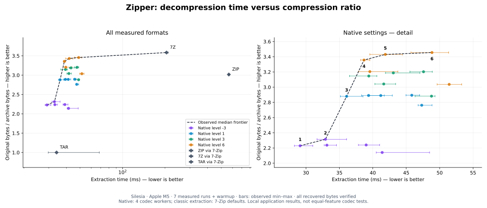

# Performance and the Pareto frontier

The curve compares complete extraction time with compression ratio on Silesia's
12-file, 211,938,580-byte corpus. Higher and further left is better. The dashed
line connects non-dominated measured configurations; horizontal bars show the
observed minimum and maximum of seven runs. It is an empirical frontier on this
machine and corpus, not a claim of global optimality.

Twenty native configurations cover levels -3, 1, 3, and 6 with block sizes from
64 KiB to 16 MiB. ZIP, 7z, and TAR points measure **Zipper extracting those actual
formats** through its installed 7-Zip backend. They do not represent native Rust
ZIP/LZMA2 decoders. The report also compares these paths with direct 7-Zip calls.

[Full tables, methodology, reproduction commands, and raw samples](../benchmarks/silesia/README.md)
include compression speed and peak creation memory, which are absent from this
two-dimensional plot. [PNG](../benchmarks/silesia/pareto.png) and
[PDF](../benchmarks/silesia/pareto.pdf) versions are available.

Native defaults remain level 1 and 1 MiB blocks. Larger blocks improve some
higher-level compression ratios but increase memory, selected-file decoding work,
and often full extraction time. The default is a tradeoff, not the smallest
archive or highest speed on every input.

Measurements use an Apple M5 with 32 GiB RAM. Native decoding requests four codec
workers; classic decoding uses the backend's default allocation. Archives differ
in metadata support. Verification compares all restored bytes, file sizes, and
directory membership. Timings include startup and filesystem writes but not
explicit extraction sync. Cache/thermal/storage isolation and cross-machine
benchmarking remain outstanding.

Earlier development-fixture results and kept/rejected experiments are recorded
in the [v2 report](../benchmarks/v2/README.md). For comparisons against tar+zstd,
use the [matched-sync measurements](../benchmarks/v2/zstd-fullsync.md): earlier
macOS runs accidentally compared Rust's `F_FULLFSYNC` with ordinary `fsync` on
tar output, overstating the creation-speed gap.
