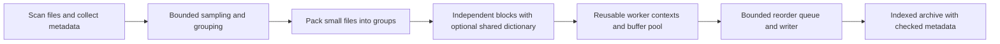

# Zipper: compression research and a route to the frontier

Research date: 29 October 2026. Scope: lossless general-purpose archiving, with
fast creation and extraction, useful compression ratios, and bounded resources.
This is a research agenda, not a claim that the proposed improvements exist.

The [30 October extraction architecture review](#extraction-first-review-30-october-2026)
updates the priorities below using the subsequent implementation and measurements.

## Assessment

Zipper should aim to lead a measurable part of the speed/size frontier on modern
CPUs, then expand that territory. The most credible initial target is mixed
developer and application trees: many small files, related source files, binaries,
and some incompressible content. A second target is structured exports and logs.

The present engine is a useful prototype. Its fast results against one LZMA2 preset
do not establish a new compression technique. Independent parallel Zstandard
frames are established practice: upstream PZstandard already implements parallel
compression and decompression that way. The Zstandard seekable format also
defines independent frames and a trailing index. These are baselines to improve
on, not inventions to claim. [PZstandard](https://github.com/facebook/zstd/tree/dev/contrib/pzstd),
[seekable format](https://github.com/facebook/zstd/blob/dev/contrib/seekable_format/zstd_seekable_compression_format.md).

We should distinguish four kinds of evidence throughout development:

- **Local measurements:** verified on this machine, with raw samples retained.
- **Published measurements:** reported by authors or maintainers on their hardware.
- **Established mechanisms:** inspectable formats, implementations, and papers.
- **Zipper hypotheses:** proposed experiments with explicit acceptance criteria.

No implementation, academic paper, or vendor graph alone proves universal
leadership. A useful frontier comparison includes compressed size, encode time,
decode time, memory, and the access pattern. Improving one while worsening another
is a tradeoff, not domination.

## The competitive landscape

| Area | What to study and benchmark | Consequence for Zipper |
| --- | --- | --- |
| Balanced general-purpose compression | Zstandard across fast and positive levels; tar+zstd; tar+pzstd | Mandatory baselines using the same underlying codec |
| Maximum CPU throughput | LZ4, LZ4HC, Snappy; emerging ZXC, LZAV, memlz | A fast mode must compete with lightweight codecs, not only LZMA2 |
| Dense conventional compression | 7-Zip/LZMA2, Fast LZMA2, Brotli, libbsc, bzip3; ZPAQ as a slow ratio reference | Establish the cost of buying additional space savings |
| Structured data | OpenZL; lossless Blosc2 filters and codecs | Data representation can improve both size and speed |
| File collections | DwarFS; permutation/partition approaches for source collections | Similarity and packing are already sophisticated elsewhere |
| Architecture-specific implementations | AMD AOCL; Apple Compression; Rust alternatives | Compare optimized implementations, not only format names |
| Distribution workloads | Oodle Kraken/Mermaid/Selkie where an evaluation SDK is available | Commercial decode-focused systems belong in the competitive picture |
| Accelerators | nvCOMP, GDeflate, hardware decompression | Useful optional targets, with transfer costs included |

The [lzbench project](https://github.com/inikep/lzbench) integrates numerous codecs
under a common build and verifies decoded bytes. Its codec inventory includes
recent entrants as well as established implementations. Use its results to select
challengers, then reproduce locally; its in-memory numbers cannot be directly
compared with our filesystem timings. Its
[results explorer](https://inikep.github.io/lzbench/) also separates compression and
decompression frontiers. Pin the harness commit and bundled codec versions.

[LZ4](https://github.com/lz4/lz4) supplies an acceleration control, an HC encoder,
and dictionary support. [libdeflate](https://github.com/ebiggers/libdeflate) is a
useful reminder that a mature format can gain substantially from implementation
work; its whole-buffer API is designed for chunked use. Neither merely choosing
Rust nor designing a new container guarantees a faster byte codec.

[Fast LZMA2](https://github.com/conor42/fast-lzma2) uses a parallel radix match finder;
its authors document a compression speed/size tradeoff and increased dictionary
requirements when trying to match 7-Zip's ratio. Its historical benchmark is not
evidence against current 7-Zip. Measure the current implementations ourselves.

[AMD AOCL](https://github.com/amd/aocl-compression) includes CPU dispatch, parallel
implementations, random-access metadata, and decode-speed-oriented settings.
[Oodle](https://www.radgametools.com/oodlemermaidselkie.htm) is explicitly designed
around fast decoding for games. Vendor performance claims for either are leads
to test, not cross-machine results to paste into our leaderboard.

Apple's [LZFSE documentation](https://developer.apple.com/documentation/Compression/COMPRESSION_LZFSE)
and [LZMESH documentation](https://developer.apple.com/documentation/compression/compression_lzmesh?changes=__5)
are relevant to the Mac target. The latter specifies OS version 27 or later;
our benchmark machine runs 26.7.1, so LZMESH is a watchlist item rather than a
present local baseline. Do not make a portable archive require an Apple-only decoder.

## Findings with the greatest practical value

### 1. Preserve cross-file redundancy without creating a serial archive

DwarFS already clusters similar files, deduplicates, segments data, and treats
categories differently. Its builder has separate scanning, ordering, block
construction, and compression work. This is especially relevant to our per-file
loop. [DwarFS overview](https://github.com/mhx/dwarfs),
[builder documentation](https://github.com/mhx/dwarfs/blob/main/doc/mkdwarfs.md).

The 2025 paper *On the compressibility of large-scale source code datasets*
studies ordering and partitioning on large Software Heritage collections,
including individual-file access. It provides evidence that independently
compressing each source file leaves substantial redundancy unused, and that
ordering/block size affect both ratio and access cost.
[Paper](https://www.dicosmo.org/Articles/2025-04-16-JSS-final-published-open-access.pdf).

**Zipper hypothesis:** group similar small files into bounded solid groups, then
encode independently addressable blocks inside those groups. Compare cheap
extension/path ordering with sampled similarity ordering before paying for a
global clustering pass. Separate metadata from payload so repeated paths and
attributes can also compress.

Immutable dictionaries stored once per group can share history across independent
blocks without requiring the decoder to reconstruct all preceding blocks.
Zstandard documents trained dictionaries as particularly effective for correlated
small samples. Dictionary bytes, training time, and dictionary-cache memory must
all count in the result. [Zstandard dictionary guidance](https://github.com/facebook/zstd#the-case-for-small-data-compression).

These alternatives need an ablation: packing alone; packing plus ordering;
dictionary alone; packing plus dictionary. An improvement over v1 is not sufficient;
the winning configuration must compete with tar+pzstd and DwarFS.

### 2. Treat structured data as more than bytes

OpenZL represents compression as a graph of reversible operations and emits a
self-describing stream for its decoder. Its 2026 paper discusses parsing,
clustering streams, and training compression graphs. This is evidence that
specialization can be engineered as reusable components rather than one codec
per application. [OpenZL paper](https://arxiv.org/html/2605.09928v1).

The launch article also describes the limits: unstructured text may just fall
back to Zstandard, and parsing CSV can cap throughput despite better compression.
Do not assume specialization is automatically faster.
[OpenZL introduction](https://engineering.fb.com/2025/10/06/developer-tools/openzl-open-source-format-aware-compression-framework/).

Blosc2 supplies another concrete precedent: multi-level chunk containers, codec
selection, dictionaries, and filter pipelines including byte/bit shuffling and
delta transforms. Only exactly reversible filters belong in a lossless archiver;
precision truncation does not.
[Blosc2 design](https://blosc.org/c-blosc2/c-blosc2.html),
[container API](https://blosc.org/c-blosc2/reference/schunk.html).

**Zipper hypothesis:** a small, versioned transform set for selected categories
can move the size/speed frontier more than swapping general-purpose codecs.
Start with fixed-width numeric byte shuffles/deltas and executable transforms.
XZ supplies established BCJ filters, including ARM64, as prior art.
[XZ filter documentation](https://www.tukaani.org/xz/man/xz.1.html).

JSON and CSV transforms must preserve the original bytes, including whitespace,
field order, number spellings, quoting, and newlines. A parser that reserializes
equivalent objects is not lossless. Preserve these details explicitly or decline
the transform. Charge detection, parsing, fallback, and reconstruction to timings.

### 3. Optimize the decoder's representation, not just its loop

ZXC is an important emerging challenger for decode-heavy workloads. Its current
README reports substantially faster decoding than LZ4 at selected ratio tiers,
including ARM64 results, but higher compression levels can spend much more time
encoding. These are maintainer measurements, not results reproduced by Zipper.
[ZXC benchmark and implementation](https://github.com/hellobertrand/zxc).

Its whitepaper describes separated literal/token/offset sections, compact sequence
layouts, and SIMD-oriented entropy decoding. The mechanism worth studying is
removing serial dependencies and making memory access predictable.
[ZXC design](https://github.com/hellobertrand/zxc/blob/main/docs/WHITEPAPER.md).

PivCo-Huffman (2026) rearranges Huffman coding into node bitmaps so decoding can
use SIMD operations rather than following a variable-length symbol chain.
It has a public implementation and author benchmarks. Encoding cost, padding,
working memory, scalar performance, and the full codec must all be measured.
[Paper](https://marcinzukowski.github.io/pivco-huffman/paper-1.0/ph.html),
[implementation](https://github.com/MarcinZukowski/pivco-huffman).

Recoil, published at ICPP 2023, investigates parallel rANS recovery using saved
intermediate states and adjustable split metadata. It addresses entropy decoding,
not all the history dependencies of an LZ decoder. Adopting its idea would not
automatically make an existing Zstandard stream independently decodable.
[Recoil](https://arxiv.org/html/2306.12141v2).

**Zipper research track:** prototype a decode-cost-aware parser, then independently
test a SIMD-friendly literal/sequence representation. Penalize expensive match
patterns using measured cycles, not simply encoded bits. Start with an objective
such as `encoded_bits + lambda * estimated_decode_cycles`, calibrated separately
for target architectures. This is a design hypothesis, not a novel result yet.

For match-finding experiments, Zstandard exposes sequence-producing APIs, allowing
some encoder experiments to retain its decoder. The pinned 1.5.7 header must be
the authority: the block-level external-producer API has restrictions involving
dictionaries/history, long-distance matching, and internal multithreading. Do not
assume it composes with our proposed dictionary mode. Use a separately controlled
experiment or evaluate the frame-level API's own contract.
[Zstandard 1.5.7 API](https://github.com/facebook/zstd/blob/v1.5.7/lib/zstd.h).

### 4. Rust is an engineering choice, not the performance result

The new mzstd project reports a safe-Rust implementation and comparisons against
libzstd. Its reported median includes empty/tiny inputs and cold context creation;
some compressible-text cases remain slower. That makes it a candidate for both
warm-context and cold-context comparisons on our actual block sizes, not an
automatic replacement. [mzstd](https://github.com/M-Compressors/mzstd).

Keep the archive, scheduling, validation, and public API in Rust. Maintain a narrow
codec interface so C-backed and Rust-native implementations can compete under
identical inputs, output limits, compiler settings, and thread budgets. Treat
conformance, fuzz coverage, and compatibility as part of backend maturity.

### 5. Deduplication and accelerators need an economic case

FastCDC is established work on reducing the cost of content-defined chunking for
deduplication. It does not eliminate the cost of scanning and hashing every byte,
and it does not promise benefits on unrelated inputs.
[FastCDC, USENIX ATC 2016](https://www.usenix.org/conference/atc16/technical-sessions/presentation/xia).

**Hypothesis:** make whole-file deduplication and content-defined chunking optional
for backup/versioned-tree profiles. Charge detection and index memory, and bound
reference depth so a small-file extraction cannot require an unbounded recovery
chain. Check candidate duplicates with a strong identity check; a similarity hash
is never proof that two blocks are identical.

nvCOMP supports multiple GPU codecs, while NVIDIA's hardware decompression engine
supports a specific subset. GPU library support for Zstandard must not be confused
with hardware DE support for it. Hardware availability and transfer topology
matter. [nvCOMP](https://docs.nvidia.com/cuda/nvcomp/),
[algorithm/backend selection](https://docs.nvidia.com/cuda/archive/13.4.1/nvcomp/algorithm_selection.html).

GDeflate illustrates why format design matters: its bitstream organization exposes
32-way parallelism while retaining DEFLATE-like coding.
[Microsoft reference](https://github.com/microsoft/DirectStorage/blob/main/GDeflate/README.md).

For Zipper, benchmark `read + host/device transfer + codec + return transfer + write`
before selecting a GPU backend. GPU-resident destinations are a separate workload.
The current M5 machine cannot establish NVIDIA results. Keep a CPU decoder and
avoid making GPU availability a condition for opening an archive.

Neural prediction is a legitimate compression research direction, as illustrated
by [Language Modeling Is Compression](https://deepmind.google/research/publications/39768/).
Our recommendation is to defer large-model payload coding until its complete
decode and model-distribution costs meet the throughput objective. Small learned
selectors for existing codecs/transforms are a more direct experiment.

## Proposed v2 architecture

This is a proposal. The current format should remain readable while v2 is
experimental. The research should settle the following contracts before freezing
the layout:

| Concern | Proposed contract | Why it matters |
| --- | --- | --- |
| File manifest | Paths, types, attributes, sizes, and ordered payload extents | File boundaries need not be compression boundaries |
| Blocks | Codec/transform ID, sizes, checksum, optional dictionary ID | Explicit decode and resource requirements |
| Dictionary dependencies | Immutable, embedded, bounded per group | Shared redundancy without serial previous-block dependence |
| Index | File-to-block extents and physical offsets, with integrity checks | Fast listing and selective extraction |
| Streaming | Forward records plus a trailing index; seekable readers use the index | Avoid requiring a full input scan merely to list files |
| Memory budget | Byte-counted queues, contexts, metadata, dictionaries, and buffers | A task-count bound alone does not bound memory |
| Publication | Verified temporary output; explicit durability mode | Compare equivalent output guarantees |
| Compatibility | Legacy readers isolated behind the same extraction policy | Native speed experiments do not weaken existing-format handling |

Replace the read-eight/compress-eight/write-eight barrier with an overlapped
pipeline. Reuse worker-local codec contexts and buffers. Avoid nested codec thread
pools when the archive scheduler already owns parallelism. Use a bounded reorder
window, or independent indexed block locations, so one slow block cannot cause
unbounded buffering. Metadata discovery should also have a bounded-memory option.

Candidate block sizes: 64 KiB, 256 KiB, 1 MiB, 4 MiB, 16 MiB. Candidate group
budgets: 4–64 MiB. These are experiment ranges, not chosen defaults. Measure full
extraction and single-file read amplification together. A 4 KiB file requiring a
16 MiB decode can make a great full-extraction result a poor interactive product.

## A benchmark standard strong enough to support the ambition

Use three suites. Codec microbenchmarks isolate match finding, parsing, entropy
coding, checksum cost, allocation, and memory copies. Container benchmarks use
identical payloads and codec configurations. Application benchmarks include file
discovery, metadata, filesystem writes, integrity checks, and publication.

Begin with [Silesia](https://sun.aei.polsl.pl/~sdeor/index.php?page=silesia) for
comparability, and [Canterbury](https://corpus.canterbury.ac.nz/descriptions/) for
small and pathological inputs. Add version-pinned source trees, binaries, real
multilingual logs, structured numeric exports, already-compressed media, and
large mixed directories. Existing synthetic corpora remain diagnostic fixtures.
Do not let one highly redundant file family stand in for all small files.

Required protocol:

1. Pin corpus hashes, tool commits, compiler flags, codec versions, OS, CPU, and
   thread counts. Keep training/tuning and evaluation families separate.
2. Compare level sweeps and nondominated points. Report the fastest observed
   configuration meeting the same size and memory budget; do not equate level 1
   across different codecs. Disclose gaps where no comparable point exists.
3. Use warmups, randomized/interleaved order, repeated runs, raw samples, and
   confidence intervals. Make primary timed tasks long enough to escape startup
   noise. Test sustained workloads, not just cache-resident bursts.
4. Separate warm-cache, cold/storage-limited, and durable-write results. Use the
   same metadata and checksum guarantees, or state the mismatch. Record CPU time,
   peak RSS, and files/second alongside payload throughput; measure energy where
   supported. Equal requested threads do not imply equal CPU consumption.
5. Test 1, 2, 4, and available-core configurations, then at least ARM64 and x86-64
   before a broad claim. Include slow-core and scalar fallback regressions.
6. Verify every restored byte and supported metadata, then fuzz malformed lengths,
   transforms, dictionary IDs, and dependency graphs. Enforce output and allocation
   limits. A fast decoder must remain correct on adversarial streams.
7. Publish both per-dataset results and a declared aggregate; include regressions.
   Never average raw throughputs across unequal datasets without explaining the
   weighting. Use independent reproduction before announcing a frontier result.

An approximate overlapped extraction model is
`T ≈ max(compressed_bytes / read_bandwidth, original_bytes / decode_bandwidth,
original_bytes / write_bandwidth) + metadata_cost` when stages can truly overlap.
On one shared device, contention invalidates the independent-bandwidth assumption.
For serial transfer-plus-decode, time is closer to the sum. This explains why
the fastest decoder and the smallest archive can each lose on a particular device.

## Experiments and decision gates

The following targets are proposed engineering gates, not predicted gains.

| Priority | Experiment | Evidence required to keep it |
| --- | --- | --- |
| P0 | Strong baselines: tar+zstd, tar+pzstd, LZ4, ZXC, DwarFS, 7-Zip sweeps | Reproducible frontier and bottleneck profile before optimizing |
| P1 | Context/buffer reuse and overlapped pipeline | At least 15% throughput gain on an affected real workload, unchanged archive bytes, bounded RSS, no material regression elsewhere |
| P1 | Small-file packing and compressed metadata | Close the v1 size gap to packed Zstandard while retaining extraction benefit; publish individual-file access cost |
| P2 | Similarity ordering and per-group dictionary | Net gain after grouping/training/storage overhead; held-out file families and bounded memory |
| P2 | Sampled codec/transform selection | Within 5% of a declared offline objective oracle on held-out workloads, with selector overhead below 2% of total time |
| P2 | Reversible numeric and executable transforms | At least 10% smaller at no slower total encode/decode on a named workload family, or an explicitly useful tradeoff |
| P3 | Decode-cost-aware parse and SIMD entropy layout | At least 20% faster decode at no larger size on a declared corpus, with encode cost reported and a second architecture replication |
| P3 | Optional deduplication / accelerator path | Better complete application time or size at a declared memory/latency budget, including scans and transfers |

For the adaptive selector, first build an expensive offline oracle that tries all
allowed configurations and records size and time. Then predict one configuration
from bounded samples. Sample multiple regions so a random prefix cannot cause
the whole file to be misclassified. Always preserve correctness on fallback, and
retain raw storage when compression is not worthwhile. Compare the learned policy
with a simple rule table; complexity must earn its place.

The potential research contribution is a jointly measured policy over grouping,
dependency boundaries, transforms, parsing, and decode cost under explicit
constraints. Each component has prior art. Novelty would need to come from a
specific algorithm or demonstrated combination that improves a published frontier,
not from calling a codec selector adaptive.

The first credible product milestone is a portable Rust archiver that competes
with packed parallel Zstandard on size, improves end-to-end extraction on mixed
trees, and offers bounded random access. Keep a separate experimental codec track
so product progress and genuine codec research can reinforce each other.

## Source and version cautions

Primary sources were preferred: project implementations, format specifications,
maintainer documentation, and original papers. Published benchmark values are
not mixed numerically with local timings. Search snippets were treated only as
discovery; direct pages sometimes disagreed with snippets or cached release links.

The Zstandard latest-release page resolved to
[v1.5.7](https://github.com/meta/zstd/releases/tag/v1.5.7); its development header
already advertised 1.6.0. OpenZL's release page resolved to
[v0.3.0](https://github.com/facebook/openzl/releases/tag/v0.3.0). ZXC's current
README benchmark names 0.15.0 while the fetched latest-release page resolved to
0.14.1. Pin exact revisions when reproducing newer claims rather than silently
combining README, whitepaper, and release versions.

The [local baseline](../benchmarks/README.md) remains evidence for the tested
machine and inputs. The additional same-codec comparison is documented in
[the Zstandard comparison](../benchmarks/zstd-comparison.md). No ZXC, OpenZL,
DwarFS, GPU, or new Rust-codec benchmark has been run as part of this research.

## Extraction-first review: 30 October 2026

Implementation follow-through: [portable measurements](../benchmarks/extraction-matrix/README.md)
now cover Linux/macOS plus a smaller Windows diagnostic. Retained changes are
[shared fast-ZIP entry-buffer accounting](../benchmarks/native-zip/shared-budget/README.md),
[Linux extraction caching](../benchmarks/native-zip/linux-cache/README.md), and
[reduced input read-ahead](../benchmarks/native-zip/input-buffer/README.md).
The grouped Linux fixtures exceed the threefold target in matched experiments;
the original local macOS small-file target remains unmet. These are bounded
input-path improvements, not the full executor/output redesign proposed below.
Descriptions of the old per-worker budget below refer to the review baseline.

The next objective is **complete, verified extraction**, including creating the
output tree. Decoder throughput is a component metric. The recent 10–16× gain
in ZIP integrity verification is not an extraction gain. The requested 3× faster
small-file extraction remains unachieved.

### What the measurements actually establish

On the local M5, four workers and seven measured rounds, extracting 4,000 grouped
files took 122.37 ms; writing their already-decoded bytes from RAM took 117.72 ms.
For 10,000 flat files, those medians were 318.49 and 328.71 ms. These overlapping
pipelines cannot be subtracted to assign decoder time. They do show that merely
removing decoding from our current output implementation does not approach 3×.
The RAM writer is a reference implementation, **not a physical lower bound**.
[Raw evidence and rejected experiments](../benchmarks/native-zip/threefold/README.md).

The corresponding 3× targets are 40.79 ms and 106.16 ms: approximately 98,000
and 94,000 output files per second. Each target must be compared with its baseline
again in the same session. We need a substantial change in how output work is
executed, or evidence that this target cannot be reached on a specified platform
under the same semantics. Another buffer-size tweak is not a sufficient strategy.

Four workers outperform ten on these local small-file fixtures. Separating a
serial creator from writers made things worse; positional reads, directory
batching and empty-file cloning did not demonstrate useful extraction gains.
Those failures argue against assuming that more queues or asynchronous code are
inherently faster. No current result establishes Windows extraction performance.

### Proposed execution model

Keep the v2 independent-block format and compatibility readers. Rebuild execution
around a validated extraction plan, introducing each seam only when an experiment
needs it. The plan describes directory dependencies, file extents, decode units,
expected sizes/checksums and metadata. A ZIP decode unit is normally one entry;
a v2 unit is one independently compressed block. Format adapters keep their
validation rules rather than forcing all formats into an unsafe common parser.

The executor should account for four distinct resources:

- CPU workers for decoding and checksums, under one total CPU budget.
- Compressed and decoded buffers under one byte budget, including queued work.
- Outstanding output operations and open descriptors under separate limits.
- Metadata/index storage and format limits, reported separately from buffer use.

Today a per-worker fast-ZIP allocation cap and separate v2 decode/write pools do
not constitute a process-wide resource contract. Reserve buffer capacity before
scheduling work; release it only after all consumers finish. Streaming fallback
must work when a whole-buffer decode does not fit. Describe an allocation budget
honestly: it is not an exact RSS limit once libraries, stacks and allocators count.
[libdeflate's whole-buffer API](https://github.com/ebiggers/libdeflate) makes this
tradeoff explicit.

Decode into owned reusable buffers, then pass bounded references to output
extents. Avoid additional copies where lifetimes allow, but measure bytes copied
before adding complex lifetime machinery. Let scheduling balance input locality,
directory contention and completion of large files. A filesystem I/O limit must
be independent of CPU count; test a simple calibrated policy before an adaptive
controller. The present macOS four-worker heuristic is evidence for two fixtures,
not a portable scheduling law.

Private staging, exclusive creation, path validation, exact length and checksum
checks, and publication only after every task succeeds remain invariant. Failure
must drain/cancel work safely and clean up. Rename publication is not a claim of
crash durability. Add metadata fidelity and output-size limits to the product
contract; the fast ZIP reader currently preserves bytes and directories only,
and the backend remains the default. A benchmark-only fast option is not yet the
user-visible extraction engine we intend to ship.

### Separate the research tracks

| Workload | Hypothesis to test | Decisive measurement |
| --- | --- | --- |
| Many tiny files | Namespace operations, filesystem contention or filter overhead dominate; an OS-specific output implementation can reduce them | RAM-to-tree and full extraction, files/s, syscall/CPU traces, bounded RSS, same metadata |
| A few large ZIP entries | Entry-level scheduling leaves cores idle inside a large Deflate stream | Single-entry and mixed-size ZIPs, decode-only and extraction, memory and correctness |
| Native mixed trees | Block layout and scheduling can balance compression locality with output readiness | Size/time/RSS frontier plus selected-file read amplification |
| Duplicate-rich trees | Shared content can reduce stored bytes and repeated decoding | Unique bytes decoded, output time and archive size including dedup construction cost |

For Linux, prototype batched open/write/close operations with io_uring only after
a trace identifies syscall or descriptor overhead. Its direct descriptors avoid
some shared file-table overhead; they do not remove filesystem namespace work.
Maintain bounded queue depth and a synchronous fallback. This is a hypothesis,
not a predicted speedup. [Upstream openat/direct-descriptor documentation](https://github.com/axboe/liburing/blob/master/man/io_uring_prep_openat.3).

For Windows, collect ETW traces on ordinary NTFS before choosing a new backend.
Record storage, filesystem, antivirus/filter configuration and cache state. Test
Dev Drive separately: it uses ReFS and different filesystem/security settings,
so its results must not be pooled with NTFS or attributed solely to Zipper.
Do not change antivirus settings to manufacture a win.
[Microsoft Dev Drive documentation](https://learn.microsoft.com/en-us/windows/dev-drive/).
For macOS, investigate APFS metadata and thread contention in system traces;
keep the current simple parallel writer as the baseline to beat.

For large ZIP entries, investigate parallel Deflate decoding as a distinct
algorithmic project. Rapidgzip demonstrates speculative parallel decoding of
arbitrary gzip data, resolving unknown history through a cache/prefetch design.
It is relevant prior art, not an already-integrated ZIP decoder. Raw Deflate
entry boundaries, cancellation, bounded memory, CRC validation and malicious
inputs would all need proof and tests. Keep libdeflate/streaming fallback when
parallel startup costs exceed the benefit.
[Rapidgzip paper](https://arxiv.org/abs/2308.08955).

For the native format, optimize creation for measured decode cost as well as
ratio: choose block boundaries and grouping that expose parallelism without
excessive read amplification. Independently indexed blocks already provide the
foundation. A new format version is justified only by a measured benefit that
v2 cannot express. In particular, v2's cumulative file offsets cannot represent
shared content extents. Any archive deduplication design must be versioned;
the current duplicates command only reports byte-verified equality. Neither
small-file fixture contains redundant payload bytes, so deduplication cannot
explain away the current bottleneck. Reflinks need platform and metadata-safe
fallbacks; hardlinks would change independent-file semantics.

Mounting an archive is a separate product opportunity when the actual need is
fast access to a few files. DwarFS supplies relevant mountable, deduplicating
filesystem prior art. Measure time to first useful read and subsequent workload
latency there, never report mount time as full extraction time.
[DwarFS](https://github.com/mhx/dwarfs).

### Ordered implementation gates

1. **Establish portable evidence first.** Extend the rerunnable harness to Windows
   and collect real source/application trees alongside synthetic size sweeps.
   Include flat/deep layouts, empty files, 100k files, large single-entry ZIPs,
   duplicate-rich data and incompressible inputs. Million-entry ZIP experiments
   require explicitly revisiting the current 100k-entry safety limit; do not
   silently bypass it. Preserve corpus manifests and input hashes.
2. **Instrument the critical path.** Record planning time, decoder CPU, queue wait,
   bytes copied/read/written, active output operations and peak memory. Collect
   filesystem traces outside timed runs. Stage times overlap: their sum is not
   wall time. Compare no-output decode, RAM materialization and full extraction.
3. **Prove an output improvement before integrating it.** Implement the smallest
   platform-specific diagnostic justified by the trace. Require exact tree/byte
   checks, failure cleanup and repeatable end-to-end improvement before putting
   it behind the production sink interface. Rejected prototypes stay rejected
   unless a new workload or concrete mechanism changes the hypothesis.
4. **Introduce shared resource accounting incrementally.** Use fixed memory tiers
   and explicit CPU/I/O limits; compare against current RSS and speed. Independent
   review is required for concurrency changes. No broad executor rewrite without
   a workload showing why each new mechanism is needed.
5. **Pursue parallel Deflate and native layout separately.** Each needs its own
   controlled baseline and fallback. Do not mix codec, scheduler and file-output
   changes in one experiment or attribute their combined result to one feature.

Compare identical legacy archives against current 7-Zip and libarchive, and
native archives against tuned tar, tar+pzstd and competitive codecs. Match bytes,
metadata policy and durability; report warm and controlled cold-cache runs
separately. If cold state cannot be established, label it unknown. Include whole
process-tree memory for subprocess pipelines. Publish raw samples, medians,
ranges, archive size, files/s and MiB/s; use enough runs before claiming tail
percentiles. Re-run baselines interleaved on the same host.

A credible first milestone is a reproducible extraction frontier on named real
workloads on Windows and macOS, with Linux replication, bounded resources and
complete supported metadata. The 3× goal remains an experiment target, not an
estimate. State-of-the-art requires beating strong contemporary baselines under
these contracts and making the evidence independently reproducible.
