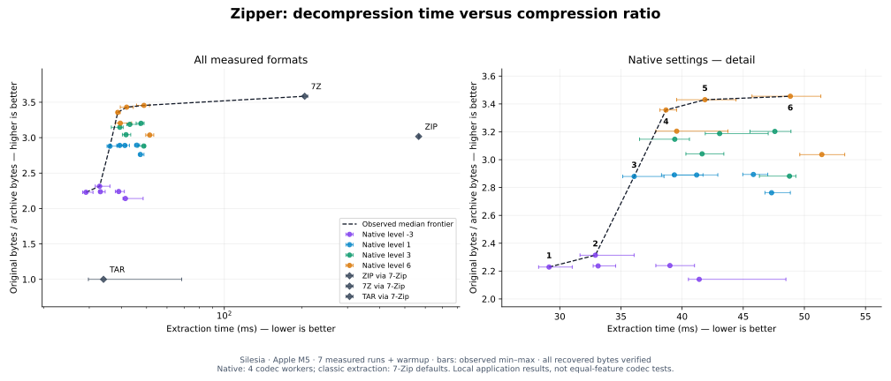

# Results

This page lists the current headline numbers for each workload. Every number is a
local measurement on the named machine. None is a cross-machine or
state-of-the-art claim. Each section links to its experiment record, which holds
the method, raw samples, and reproduction commands.

| Workload | Machine | Revision | Recorded |
| --- | --- | --- | --- |
| [Silesia](#silesia) | Apple M5, 32 GiB RAM | classic formats at `afb77d0` | 2026-10-29 |
| [Dependency sources](#dependency-sources) | Apple M5, 32 GiB RAM | `ed07524`; sweep at `b111c00` | 2026-10-30, 2026-11-01 |
| [Small files versus bsdtar](#small-files-versus-bsdtar) | Apple M5, 32 GiB RAM | baseline `99a04e4` | 2026-10-29 |
| [Windows](#windows) | Windows Server 2022 GitHub Actions runner | alpha `55bc598` versus `88bb098` | 2026-10-30 |

The "Recorded" column gives the date of the commit that added the record.

## Silesia

The corpus is Silesia, 12 files and 211,938,580 bytes. The machine is an Apple
M5 with 32 GiB RAM. The record names revision `afb77d0` for the current classic-format samples.
It does not name a revision for the native sweep. Record:
[Silesia benchmark](../benchmarks/silesia/README.md).

The plot compares complete extraction time with compression ratio. Higher and
further left is better. The dashed line connects the non-dominated measured
configurations. Horizontal bars show the observed minimum and maximum of seven
runs. The curve is an empirical frontier on this machine and corpus, not a claim
of global optimality. [PNG](../benchmarks/silesia/pareto.png) and
[PDF](../benchmarks/silesia/pareto.pdf) versions are available.

### Native frontier

| Point | Setting | Ratio | Extraction median (ms) | Range (ms) |
| --- | --- | ---: | ---: | ---: |
| 1 | L-3 / 1024 KiB | 2.229× | 29.12 | 28.27–31.02 |
| 2 | L-3 / 256 KiB | 2.314× | 32.91 | 31.65–36.08 |
| 3 | L1 / 1024 KiB | 2.879× | 36.08 | 35.15–38.52 |
| 4 | L15 / 1024 KiB | 3.474× | 36.44 | 35.29–36.96 |
| 5 | L15 / 4096 KiB | 3.627× | 40.17 | 39.33–42.55 |
| 6 | L19 / 1024 KiB | 3.705× | 40.63 | 38.83–42.44 |
| 7 | L19 / 4096 KiB | 3.863× | 44.13 | 42.99–45.06 |
| 8 | L19 / 16384 KiB | 3.970× | 52.87 | 51.31–54.11 |

Native configurations cover levels -3 through 19 with block sizes from 64 KiB to
16 MiB. Native decoding requests four codec workers.

Native defaults remain level 1 and 1 MiB blocks. Larger blocks improve some
higher-level compression ratios. They also increase memory, selected-file
decoding work, and often full extraction time. The default is a tradeoff, not
the smallest archive or the highest speed on every input.

### Classic formats

The ZIP, 7z, and TAR points measure **Zipper extracting those actual formats**
through its installed 7-Zip backend. Classic decoding uses the backend's default
allocation. An additional ZIP native point measures the opt-in parallel Rust
ZIP/zlib-rs reader on identical ZIP bytes. The record compares both paths with
direct 7-Zip calls.

| Format / reader | Ratio | Zipper median ms | Direct 7-Zip median ms |
| --- | ---: | ---: | ---: |
| ZIP L1 | 3.017× | 565.62 | 563.52 |
| ZIP L1 stream | 3.017× | 115.48 | 560.77 |
| ZIP L1 buffered | 3.017× | 91.75 | 560.77 |
| ZIP L9 | 3.274× | 538.60 | 536.80 |
| ZIP L9 stream | 3.274× | 115.64 | 536.80 |
| ZIP L9 buffered | 3.274× | 92.61 | 536.80 |
| 7Z L1 | 3.584× | 204.76 | 205.30 |
| 7Z L9 | 4.353× | 1051.27 | 1048.61 |
| TAR | 1.000× | 34.06 | 33.34 |

Native ZIP preserves bytes and directories only. The 7-Zip backend remains the
default. ZIP buffered uses libdeflate within an explicit per-worker memory cap.
ZIP stream uses zlib-rs with small streaming buffers. The plotted ZIP
measurements predate the
[shared entry-buffer budget](../benchmarks/native-zip/shared-budget/README.md)
that native-fast uses.

### Tuned bsdtar baselines

The green points T1 to T4 add tuned bsdtar baselines. They are TAR, TAR+zstd,
TAR+pzstd, and identical ZIP.

| Point | Reader | Ratio | Median ms |
| --- | --- | ---: | ---: |
| T1 | tar-1MiB | 0.996× | 43.84 |
| T2 | tar+pzstd-1MiB | 2.886× | 56.24 |
| T3 | tar+zstd-1MiB | 2.891× | 131.42 |
| T4 | bsdtar ZIP, 1 MiB | 3.017× | 182.45 |

[Matched tar comparisons](../benchmarks/native-zip/bsdtar-comparison.md) show the smaller lead against tuned
tar buffers, so the comparison does not rely only on default settings. For
comparisons against tar+zstd, use the
[matched-sync measurements](../benchmarks/v2/zstd-fullsync.md). Earlier macOS
runs accidentally compared Rust's `F_FULLFSYNC` with ordinary `fsync` on tar
output. Those runs overstated the creation-speed gap.

### Method and limits

- Archives differ in metadata support.
- Verification compares all restored bytes, file sizes, and directory membership.
- Timings include startup and filesystem writes. They exclude explicit extraction
  sync.
- Cache, thermal, and storage isolation is outstanding. So is cross-machine
  benchmarking on controlled hardware.
- The plot omits compression speed and peak creation memory. The
  [full tables, methodology, reproduction commands, and raw samples](../benchmarks/silesia/README.md)
  include them.

Separate [Linux x86 and virtual Apple M1 results](../benchmarks/cross-platform/README.md)
confirm the native ZIP gain on other architectures, with hosted-runner caveats.
Earlier development-fixture results and kept and rejected experiments are in the
[v2 report](../benchmarks/v2/README.md).

## Dependency sources

The corpus is 70 locked crates.io packages, with 3,981 regular files and
67,479,735 input bytes. The run used an Apple M5, the source `ed07524` production
reader, seven interleaved measured rounds after warmup, and four Zipper workers.
Native is level 1 with 1 MiB blocks. Record:
[real dependency-source extraction](../benchmarks/rust-dependencies/README.md).

| Reader / format | Archive bytes | Extraction ms [range] | Peak RSS MiB |
| --- | ---: | ---: | ---: |
| Zipper / .zipper | 12,243,518 | 173.64 [170.45–176.22] | 25.53 |
| Zipper native / ZIP | 14,328,097 | 174.78 [167.86–208.78] | 6.70 |
| Zipper native-fast / ZIP | 14,328,097 | 162.34 [159.90–177.42] | 7.83 |
| 7-Zip / ZIP | 14,328,097 | 442.87 [439.72–500.63] | 5.75 |
| bsdtar / ZIP | 14,328,097 | 359.79 [357.05–380.24] | 6.14 |
| bsdtar / TAR | 71,127,040 | 300.24 [295.44–322.99] | 4.44 |

On this tree, the native archive is 14.5% smaller than the tested ZIP. It
extracts 1.73× faster than tuned plain TAR. Native-fast extracts the identical
ZIP 2.22× faster than bsdtar. Native `.zipper` uses more memory and is slower
than native-fast ZIP here.

### Level and block-size sweep

The sweep used an Apple M5 (10 cores, 32 GiB RAM, macOS 26.7.1), a release
build of `b111c00`, `--threads 4`, and a warm cache. Record:
[native level and block-size sweep](../benchmarks/rust-dependencies/level-sweep.md).

| Level / block | Ratio | Archive bytes | Creation MiB/s | Extraction ms | Range ms |
| --- | ---: | ---: | ---: | ---: | ---: |
| L1 / 1024 KiB (default) | 5.511× | 12,243,518 | 591 | 193.19 | 187.01–211.47 |
| L1 / 4096 KiB | 5.641× | 11,962,766 | 579 | 181.91 | 171.33–200.66 |
| L3 / 4096 KiB | 7.347× | 9,184,575 | 542 | 187.92 | 170.66–207.12 |
| L3 / 16384 KiB | 7.578× | 8,904,481 | 469 | 183.75 | 178.13–196.68 |
| L19 / 16384 KiB | 10.555× | 6,392,933 | 18 | 190.20 | 181.52–196.30 |

- L3 / 4 MiB gives 25% fewer bytes than the default. L19 / 16 MiB gives 48% fewer.
- Every configuration of at least 1 MiB has a median between 182 and 217 ms, and
  their ranges overlap. The run does not establish a speed ranking among them.
- Extraction peak RSS is about 26 MiB at 1 MiB blocks, 63–70 MiB at 4 MiB, and
  75–84 MiB at 16 MiB.
- The default stays unchanged. For source trees where size matters,
  `--level 3 --block-size-kib 4096` is the measured cost-effective setting on
  this machine.

## Small files versus bsdtar

The run used an Apple M5 (10 logical CPUs, 32 GiB RAM, macOS 26.7.1), release
builds, and seven interleaved measured rounds after one warmup. Readers extract one unchanged
Deflate ZIP. The record names `99a04e4` as the baseline source for its
worker-policy trials. Record:
[small-file ZIP extraction versus bsdtar](../benchmarks/native-zip/bsdtar-comparison.md).

| Reader | 4,000 grouped files: median [range] ms | 10,000 flat tiny files: median [range] ms |
| --- | ---: | ---: |
| Zipper default / 7-Zip | 240.09 [238.12–242.33] | 556.65 [552.00–586.04] |
| Zipper native stream | 126.74 [125.19–128.08] | 322.32 [318.22–332.45] |
| Zipper native-fast | 126.41 [125.03–129.16] | 328.35 [313.95–372.00] |
| bsdtar default | 293.36 [287.88–324.60] | 703.32 [699.33–709.60] |
| bsdtar, 1 MiB buffer | 293.17 [290.14–294.62] | 704.14 [698.70–717.63] |
| bsdtar, 1 MiB, reduced metadata | 269.14 [267.21–270.99] | 657.09 [640.86–686.66] |

Native streaming is 2.12× and 2.04× faster than reduced-metadata bsdtar on the
grouped and flat fixtures. It is 2.31× and 2.18× faster than normal bsdtar.
Native-fast ranges overlap streaming, so the record establishes no fast-mode
advantage.

## Windows

The Windows numbers come from
[run 40987906123](https://github.com/marlboro-red/zipper/actions/runs/40987906123)
on one hosted Windows Server 2022 runner. It compares the downloadable `v0.1.0-alpha.1` executable (source `55bc598`)
with source `88bb098`. It used seven interleaved rounds after warmup and four
requested workers. Record:
[actual Windows alpha versus current source](../benchmarks/windows-release-comparison/README.md).

| Workload (native-fast ZIP) | Published alpha ms [range] | Current ms [range] | Interpretation |
| --- | ---: | ---: | --- |
| 1,000 flat files | 369.01 [333.55–1564.48] | 412.16 [338.34–1166.20] | Inconclusive; broad overlapping ranges |
| 1,000 grouped files | 295.92 [262.86–1013.48] | 398.63 [270.73–1238.99] | Inconclusive; broad overlapping ranges |
| 32 MiB compressible | 223.41 [198.52–238.16] | 30.06 [29.47–30.41] | 7.43× faster |
| 61 MiB mixed | 94.65 [94.12–95.49] | 100.94 [99.95–431.72] | 6.6% slower; separated ranges |
| 32 MiB random | 34.43 [33.70–34.69] | 39.76 [39.41–40.18] | 15.5% slower; separated ranges |

The mixed and random regressions are real in this run. The record makes no
universal Windows improvement claim. Native-format extraction showed no
established speed change.
